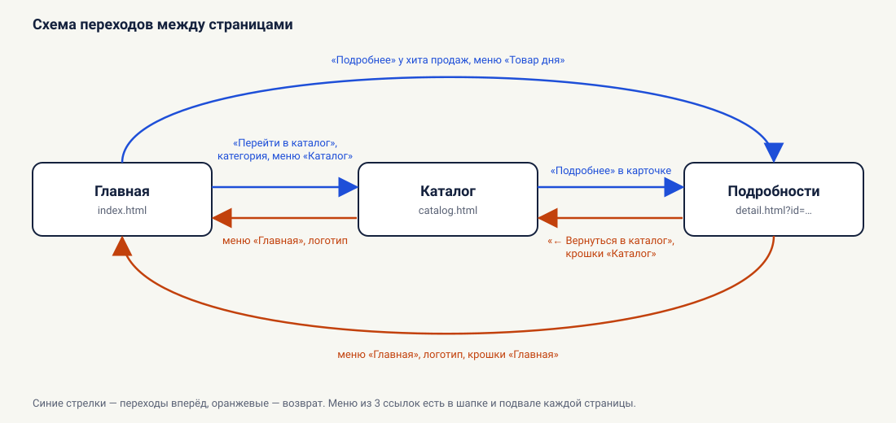
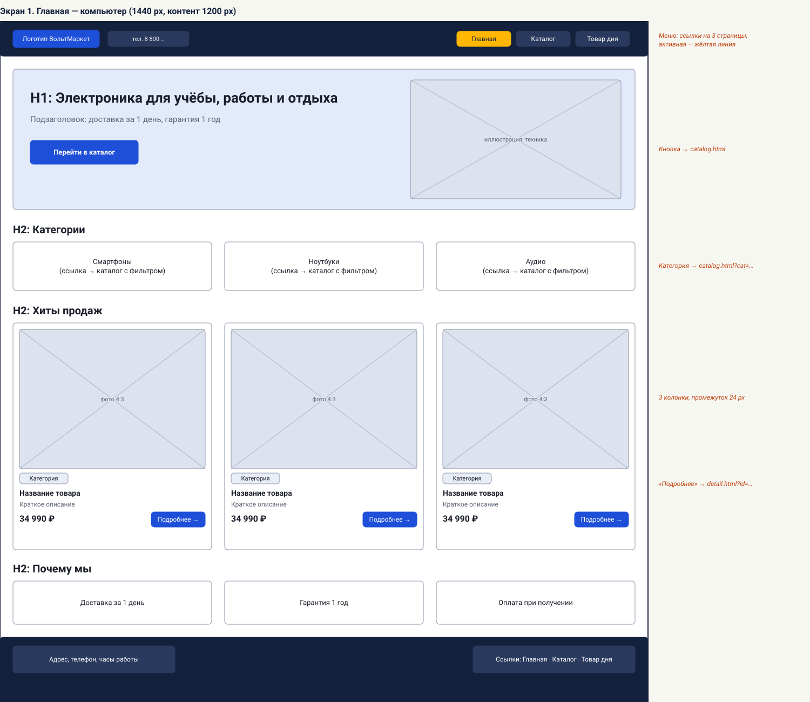
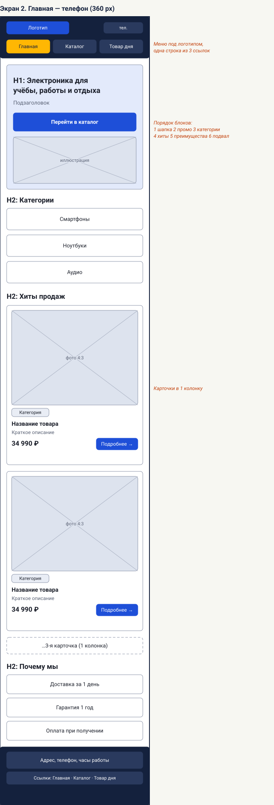
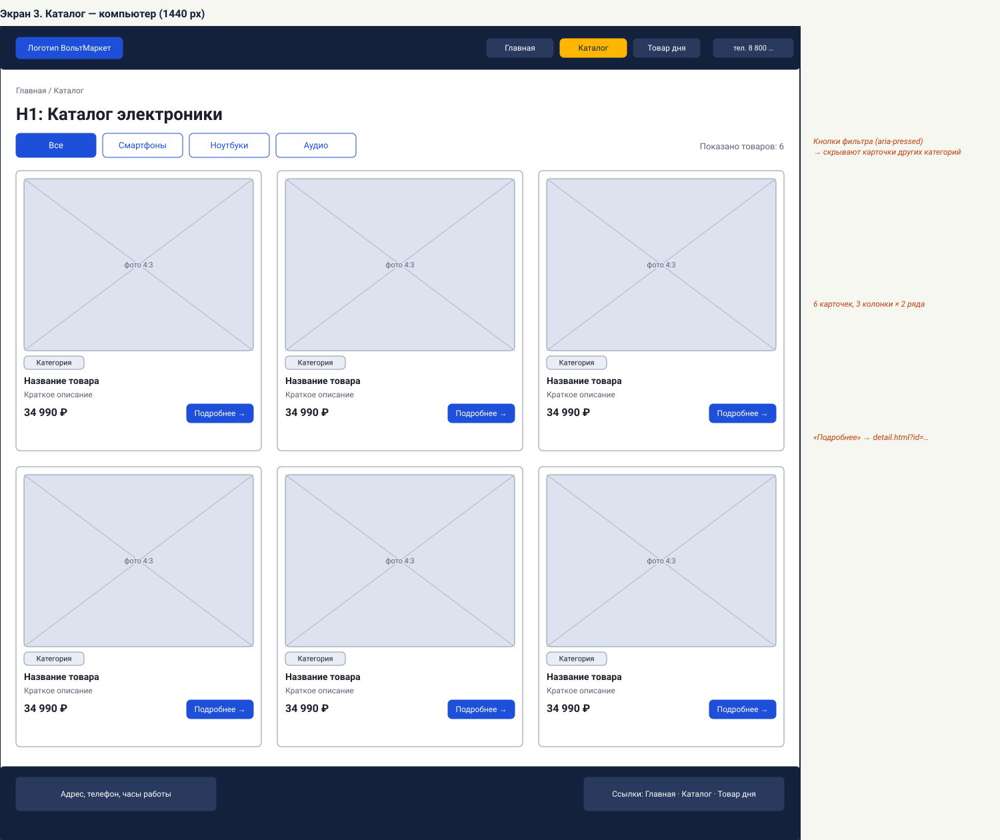
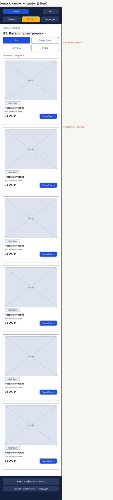
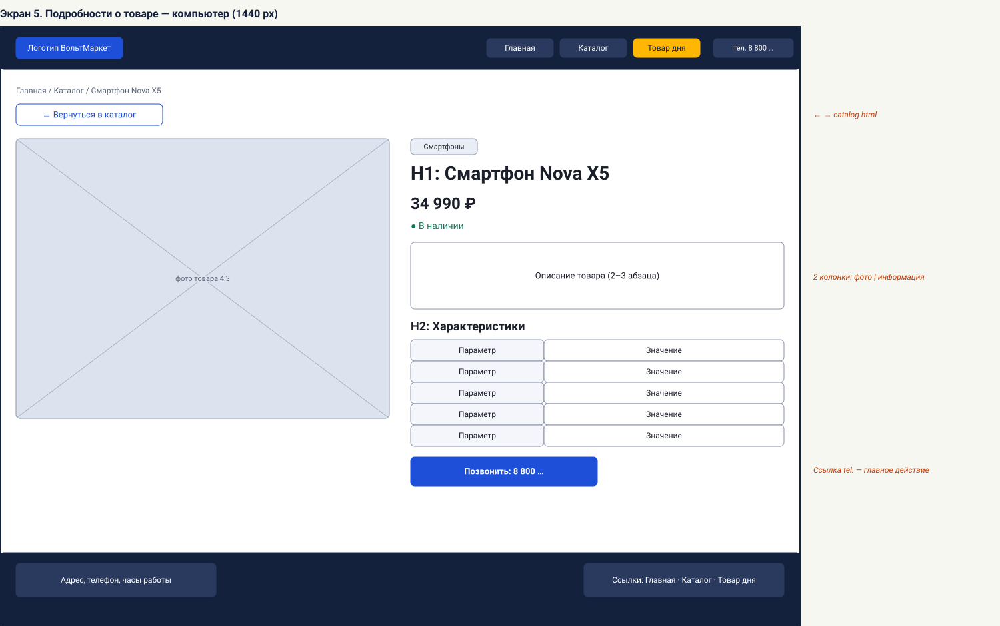
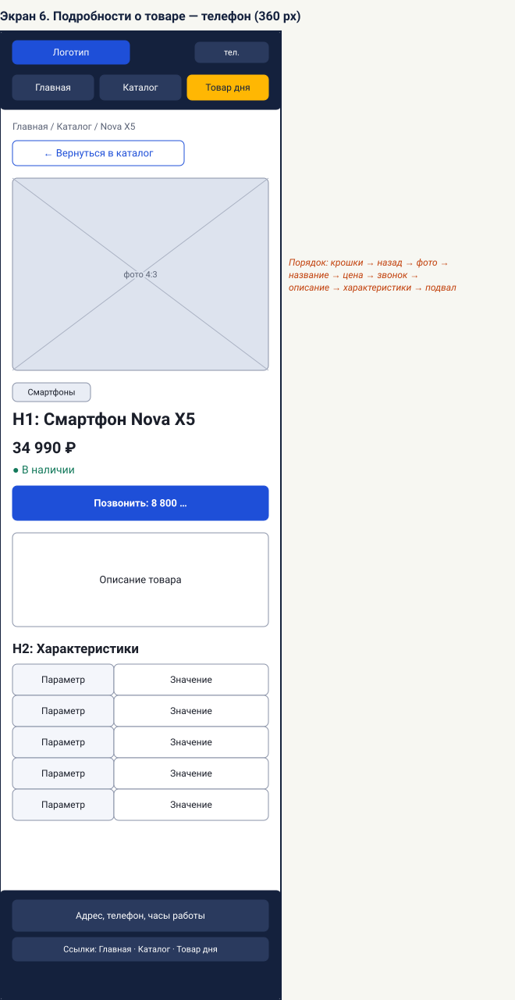

# Проектирование и прототип

## 1. Схема переходов

| Откуда | Действие | Куда |
|---|---|---|
| Главная | Кнопка «Перейти в каталог» | `catalog.html` |
| Главная | Плитка категории «Смартфоны» / «Ноутбуки» / «Аудио» | `catalog.html?cat=phones` / `laptops` / `audio` (фильтр уже включён) |
| Главная | «Подробнее» в карточке хита продаж | `detail.html?id=…` |
| Любая страница | Меню «Главная», логотип | `index.html` |
| Любая страница | Меню «Каталог» | `catalog.html` |
| Любая страница | Меню «Товар дня» | `detail.html` (товар Nova X5) |
| Каталог | «Подробнее» в карточке | `detail.html?id=…` |
| Подробности | «← Вернуться в каталог», хлебная крошка «Каталог» | `catalog.html` |
| Подробности | Хлебная крошка «Главная» | `index.html` |
| Подробности | Кнопка «Позвонить» | `tel:+78001234567` (главное действие) |

**Как пользователь попадает в каталог:** с главной (кнопка в промо-блоке, плитки
категорий) или из меню любой страницы.
**Как открывает подробности:** ссылкой «Подробнее» в карточке.
**Как возвращается назад:** ссылкой «← Вернуться в каталог» над фотографией,
хлебной крошкой «Каталог» или пунктом меню.

## 2. Прототипы экранов (6 шт.)

Оранжевым курсивом справа подписаны действия ссылок и кнопок.

| № | Страница | Устройство | Файл |
|---|---|---|---|
| 1 | Главная | Компьютер, 1440 px | [01-index-desktop.svg](prototype/01-index-desktop.svg) |
| 2 | Главная | Телефон, 360 px | [02-index-mobile.svg](prototype/02-index-mobile.svg) |
| 3 | Каталог | Компьютер, 1440 px | [03-catalog-desktop.svg](prototype/03-catalog-desktop.svg) |
| 4 | Каталог | Телефон, 360 px | [04-catalog-mobile.svg](prototype/04-catalog-mobile.svg) |
| 5 | Подробности | Компьютер, 1440 px | [05-detail-desktop.svg](prototype/05-detail-desktop.svg) |
| 6 | Подробности | Телефон, 360 px | [06-detail-mobile.svg](prototype/06-detail-mobile.svg) |

## 3. Решения по раскладке

**Количество колонок на компьютере (≥ 1024 px):**
- карточки товаров и категорий: 3 колонки;
- промо-блок главной: 2 колонки (текст | иллюстрация);
- страница подробностей: 2 колонки (фото | информация).

**Планшет (640–1023 px):** карточки в 2 колонки, промо-блок и подробности в 1 колонку.

**Меню на узком экране (< 640 px):** гамбургер не используется. Меню переносится
под логотип и занимает всю ширину: одна строка из 3 равных ссылок. Ссылки всегда видны,
скрипт не нужен, по ним можно пройти клавишей Tab.

**Порядок блоков на телефоне:**

| Главная | Каталог | Подробности |
|---|---|---|
| 1. Шапка (логотип, телефон, меню) | 1. Шапка | 1. Шапка |
| 2. Промо: H1, подзаголовок, кнопка, иллюстрация | 2. Хлебные крошки | 2. Хлебные крошки |
| 3. Категории (3 плитки в столбик) | 3. H1 «Каталог электроники» | 3. «← Вернуться в каталог» |
| 4. Хиты продаж (3 карточки в столбик) | 4. Фильтр (кнопки 2 × 2) | 4. Фото |
| 5. Преимущества (3 блока) | 5. Счётчик товаров | 5. Категория, H1, цена, наличие |
| 6. Подвал | 6. 6 карточек в столбик | 6. Кнопка «Позвонить» |
| | 7. Подвал | 7. Описание, характеристики |
| | | 8. Подвал |

## 4. Дизайн

Шрифт, цвета, размеры заголовков и правила отступов описаны в [design.md](design.md).
